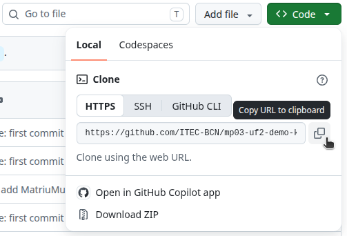

# Repositori de recursos de kotlin
- **Autor**: Raimon Izard
- **Data**: Desembre 2023

## Contingut:
1. Llibreria [Utilities.kt](src/main/kotlin/Utilities.kt)
2. Llibreria [ConsoleColors.kt](src/main/kotlin/ConsoleColors.kt)
3. Exemple [retorn múltiple en una funció](src/main/kotlin/RetornMultiple.kt)
4. Exemple [matriu de tipatge múltiple](src/main/kotlin/MatriuMultiValor.kt)

---

## Ús:
Navega la carpetes del projecte i <kbd>copy</kbd> i <kbd>paste</kbd> els fitxers que t'interessin.

>[!TIP]
>Com que es tracta d'un *repo* públic, pots clonar tot el codi usant la comanda `git clone https://github.com/ITEC-BCN/mp03-uf2-demo-kotlin-utilities-colors.git`

>[!TIP]
>També pots descarregar-te tot el codi així: 
